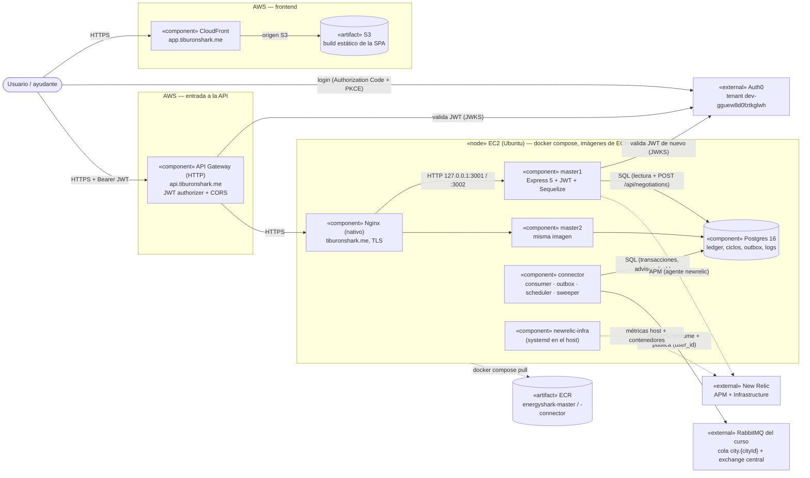

# Arquitectura: diagrama de componentes (RDOC03)

Diagrama de componentes UML en notación simplificada con Mermaid, para que GitHub lo dibuje. Los
nodos son componentes, y cada flecha es una interfaz requerida, rotulada con su protocolo. Las
decisiones detrás de cada pieza están en `docs/00-decisiones-fundacionales.md` y en `docs/adr/`.

## Componentes

| Componente | Responsabilidad | Dónde está |
|---|---|---|
| **SPA** (S3 + CloudFront) | Vistas V1–V6: login, historial de ciclos (RF01), conectividad (RF02), negociaciones (RF04), duplicados y NACKs (RF05). Solo habla con la API. | repo `franigoat/Frontend-EnergyShark` |
| **Auth0** | Emite el JWT (audience `https://api.energyshark.internal`). Lo validan el Gateway y también master. | decisiones fundacionales §1 |
| **API Gateway HTTP** | Subdominio `api.tiburonshark.me`, JWT authorizer (RNF02) y CORS restringido a `app.tiburonshark.me` (RNF01). | consola AWS |
| **Nginx** | TLS de `tiburonshark.me` y balanceo entre `master1` y `master2`. Es el único que entra a sus puertos, publicados solo en `127.0.0.1`. | `nginx/energyshark.conf` |
| **master** (x2) | API REST según `docs/contracts/openapi.yaml`. Valida el JWT en todas las rutas menos `/health` (defensa en profundidad, addendum §1). Lee de Postgres; la única escritura es `POST /api/negotiations`, que deja una fila `requested`. **Nunca toca el broker.** | `master/` |
| **connector** | Única pieza con conexión AMQP. Valida el envelope contra `docs/contracts/schemas/`, aplica al ledger, responde por el **outbox transaccional**, corre el scheduler del ciclo (reportes, fases y `request` de status-statement) y el sweeper de negociaciones (30 s y reintento con el mismo `idpk`). | `connector/` |
| **Postgres** | Fuente de verdad: `ledger_events` (log de eventos con saldos resultantes), `cycles`, `status_statements`, `distance_tables`, `pending_operations`, `outbox_messages`, `rejected_messages`. | ADR-002 |
| **New Relic** | APM del controller HTTP (agente en master) e infraestructura del host y los contenedores (`newrelic-infra`). | `docs/monitoreo.md` |
| **ECR** | Imágenes versionadas por commit. El EC2 hace `pull`, no construye. | `docs/deploy.md` |

## Por qué está separado así

- **master y connector solo se hablan por la base de datos** (ADR-001). Si el broker se cae, el
  connector reintenta con backoff y la API sigue sirviendo lo persistido (anomalía #3). Si se cae
  la API, no se pierde ningún mensaje.
- **Nada se publica directo al broker.** Toda respuesta se escribe en `outbox_messages` dentro de la
  misma transacción que la decisión, y un loop la publica con confirmación del broker. Así una caída
  entre "decidir" y "publicar" no pierde el ack ni el `negotiation-report` (anomalía #4).
- **El ledger es un log de eventos con `UNIQUE(idpk)`**, no un saldo que se sobrescribe. Un
  duplicado choca con la restricción, se registra en `rejected_messages` y no se aplica dos veces
  (anomalía #1, RF05). Cualquier ciclo pasado se reconstruye desde `ledger_events` (AD2).
- **El JWT se valida dos veces** (Gateway y master), porque `tiburonshark.me` llega a master sin
  pasar por el Gateway.

## Flujo de un ciclo (resumen)

1. Llega el `status-statement` → `connector` abre el ciclo en `cycles` (ventana de 20 min) y
   planifica la propuesta automática.
2. `transfer` y `demand-statement` → filas en `ledger_events`, con ack por el outbox.
3. Negociación voluntaria → `pending_operations` (`requested` → `awaiting_confirmation` →
   `awaiting_payment` → `settled` | `abandoned`), con timeouts de 30 s y el mismo `idpk` en cada
   reintento (ADR-003).
4. En los últimos 5 min de la ventana → el scheduler encola el `negotiation-report` con los saldos
   calculados en SQL.
5. Si un status-statement no llega → `request` con `ask: status-statement`, a lo más uno cada 5 min.
